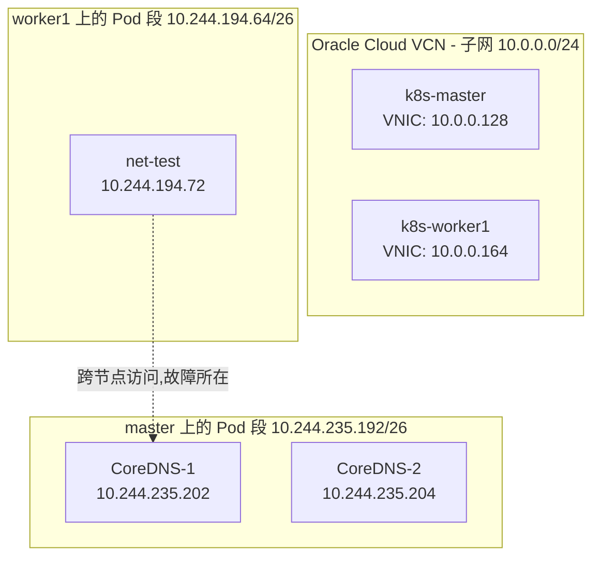
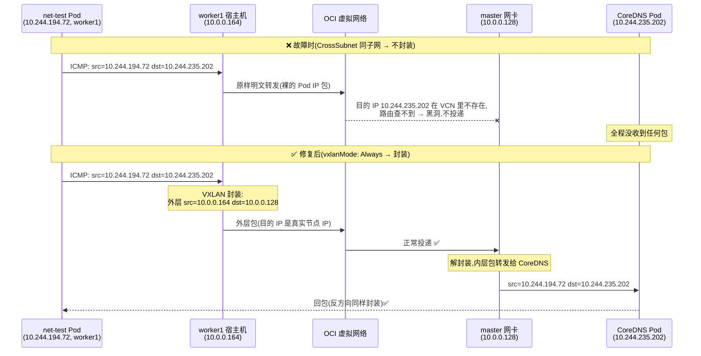
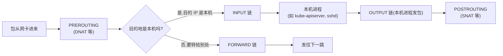
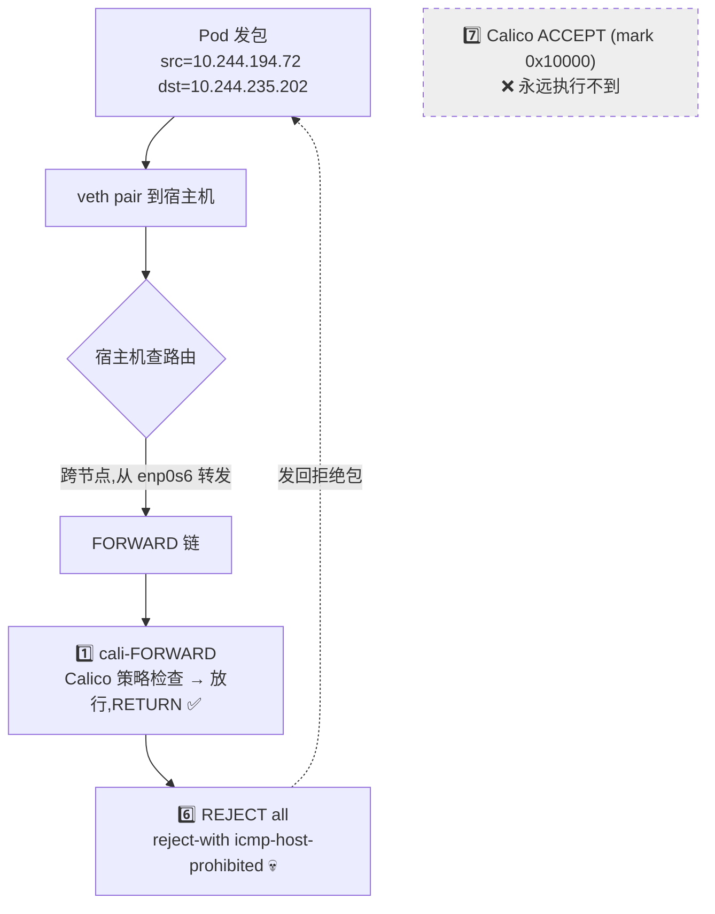
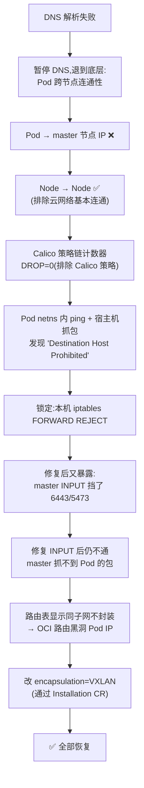

# 案例:worker 节点上 Pod 无法访问 CoreDNS(跨节点 Pod 网络故障)完整排查记录

> 日期:2026-09-01
> 难度:⭐⭐⭐⭐(对新人非常友好的一次实战,踩了新人最容易踩的所有坑)
> 最终结论:**三个问题叠加** —— iptables FORWARD 链规则顺序错误、master 重启后 INPUT 链丢失放行规则、Calico VXLANCrossSubnet 模式在 OCI 云上不走封装导致数据包被云网络黑洞。

---

## 目录

1. [集群背景](#一集群背景)
2. [问题现象](#二问题现象)
3. [排查路线全记录(怎么一步步缩小范围)](#三排查路线全记录)
4. [需要的底层知识(先补课再看根因)](#四需要的底层知识)
5. [三个根因逐一详解](#五三个根因逐一详解)
6. [修复过程](#六修复过程)
7. [最终验证](#七最终验证)
8. [经验总结与排查清单](#八经验总结与排查清单)
9. [附录:本次用到的所有排查命令](#九附录本次用到的所有排查命令)

---

## 一、集群背景

### 1.1 硬件/云环境

| 项目 | 值 |
|------|-----|
| 云厂商 | Oracle Cloud Infrastructure(OCI) |
| 节点数 | 2(master + worker1) |
| 操作系统 | Ubuntu 24.04.4 LTS,内核 6.17.0-1020-oracle |
| 容器运行时 | containerd 2.2.1 |
| Kubernetes | v1.34.11(kubeadm 部署) |
| CNI | Calico v3.31.3(**通过 tigera-operator 安装**,这一点后面很关键) |

### 1.2 网络拓扑

两台机器在**同一个 VCN 的同一个子网**里(都是 `10.0.0.0/24`),这个事实是根因三的伏笔:

```
节点名        内网 IP(VNIC)     角色
k8s-master    10.0.0.128        control-plane,6443 是 apiserver
k8s-worker1   10.0.0.164        工作节点
```

### 1.3 Pod 网络(Calico)配置

- IPPool(容器可用 IP 池):`10.244.0.0/16`,每个节点分一个 `/26` 的小段(256 个 IP 里 62 个可用)
- 封装模式:**`VXLANCrossSubnet`**(翻译:只有当两个节点"不在同一子网"时才用 VXLAN 封装;同一子网就裸传)
- 节点分到的 Pod 网段:
  - master 上的 Pod → `10.244.235.192/26`
  - worker1 上的 Pod → `10.244.194.64/26`



### 1.4 名词速查(新人版)

- **Pod IP**(如 `10.244.194.72`):每个 Pod 自己的 IP,存在于 Calico 的 IP 池里。**它只存在于集群内部,云厂商(OCI)完全不知道这个 IP 的存在。**
- **ClusterIP**(如 `10.96.0.10`,kube-dns 的 Service IP):一个"虚拟 IP",不存在任何网卡上,靠每台节点的 iptables 规则把它"转发"到真实的 Pod IP。
- **VNIC / 源目的检查(Source/Destination Check)**:云厂商给每台虚拟机网卡的默认规则——只允许收发"源 IP 或目的 IP 是本机"的数据包,其他一律丢弃。这是为了防止虚拟机被当成路由器乱转发流量。

---

## 二、问题现象

最初的报错来自一个测试 Pod(worker1 上运行):

```
net-test (10.244.194.66)  →  CoreDNS (10.244.235.194:53)
结果: No route to host ❌
```

同时 `net-test` 访问 `10.96.0.10`(kube-dns 的 ClusterIP)也失败。

### 第一眼很容易走错的方向

看到"DNS 解析不了",直觉会去查:

- ❓ CoreDNS 是不是挂了?
- ❓ kube-proxy 的 iptables 规则是不是没生成?
- ❓ CoreDNS 的配置是不是错了?

但后来意识到一个更基本的问题:**如果 Pod 连别的节点都到不了,那不管 CoreDNS 健不健康,跨节点访问都一定不通**。于是暂停 DNS 排查,退回到"先验证 Pod 的基础跨节点连通性"。

> 📌 **心得 1:排查网络问题时,永远从最底层往上层验证。**
> 层次:Pod 本身 → 同节点通信 → 跨节点通信 → Service/ClusterIP → DNS。
> 上面任何一层断了,下面测出来的"失败"都只是连带症状。

---

## 三、排查路线全记录

这一节按时间顺序记录每一步做了什么、看到什么、推出什么结论。**这是本文最有价值的部分**,因为它展示了如何像剥洋葱一样缩小问题范围。

### 第 1 步:确认 Node → Node 是通的 ✅

在 worker1 上 ping master:

```bash
# worker1 上执行
ping -c 3 10.0.0.128   # ✅ 通
```

**结论**:两台机器底层网络(OCI 虚拟网络、安全列表)对"节点自己的 IP"是放行的。

### 第 2 步:发现 Pod → master 节点不通 ❌

从 net-test Pod 里 ping master:

```bash
kubectl exec net-test -- ping -c 3 10.0.0.128   # ❌ 无响应
```

**这一步是整个排查的转折点**。它说明:

- Pod 是活的(不然 exec 都进不去)
- 同节点 Pod 网络基本正常
- 但 Pod 发出的包到不了"节点能到的地方"

### 第 3 步:确认 Pod 自己和入方向是好的 ✅

在 worker1 上 ping net-test 的 Pod IP:

```bash
# worker1 上执行
ping -c 3 10.244.194.72   # ✅ 通
```

**结论**:不是 Pod 创建坏了,入方向也通。问题聚焦在 **Pod 发出的流量经过某种"转发"环节时丢失**。

### 第 4 步:查 Calico 的策略链 —— 排除 Calico 策略误杀

在 worker1 上用 `iptables -L` + 计数器观察,发现 Pod 发往 master 的 ICMP 包确实进入了 Calico 的链:

- 进入了 `cali-from-wl-dispatch`(from workload dispatch,从工作负载出来的分发链)
- 进入了 `cali-fw-cali8e807cde39b`(这个 Pod 专属的策略链)
- 命中了 `cali-pro-kns.default`(default 命名空间的 profile),计数 10 packets
- `RETURN` 了(放行),最终 **NFLOG = 0、DROP = 0**

**结论(当时最扎实的排除)**:Calico 的网络策略**没有**丢弃这个 Pod 的流量。

> 📌 **心得 2:看 iptables 计数器(pkts 列)是排查防火墙问题的利器。**
> `iptables -L -v -n` 的第一列就是每个规则命中了多少包。包"进了哪条链、有没有被 DROP"一目了然。

### 第 5 步:在 Pod 的网络命名空间里直接 ping + 在物理网卡上抓包(决定性证据)

这是本次排查最关键的一步。做法:

1. 在 worker1 上找到 net-test 容器在宿主机上的进程 PID(通过 `ctr -n k8s.io t ls`)
2. 用 `nsenter -t <PID> -n` **钻进 Pod 的网络命名空间**直接发 ping(绕过 kubectl 的权限问题)
3. 同时在宿主机物理网卡 `enp0s6` 上 `tcpdump` 抓包

```bash
# 找到 busybox 容器的任务 PID
sudo ctr -n k8s.io c ls | grep busybox
sudo ctr -n k8s.io t ls

# 钻进 Pod 网络命名空间 ping
sudo nsenter -t <PID> -n ping -c 3 10.0.0.128
```

结果(决定性证据):

```
PING 10.0.0.128 (10.0.0.128): 56 data bytes.
From 10.0.0.164 icmp_seq=1 Destination Host Prohibited   ← ！！
From 10.0.0.164 icmp_seq=2 Destination Host Prohibited
From 10.0.0.164 icmp_seq=3 Destination Host Prohibited
```

同时 `tcpdump -ni enp0s6` 抓不到任何 Pod 发出的包。

**解读这条输出**(非常重要,新人必看):

- `From 10.0.0.164` —— 回包的"来源"是 **worker1 自己的 IP**!说明这个拒绝是**本机发出的**,包根本没离开这台机器
- `Destination Host Prohibited` —— 这是 Linux `iptables` 的 `REJECT --reject-with icmp-host-prohibited` 规则发出的标准拒绝报文(不是云厂商的风格,OCI 默默丢包不回复)
- 物理网卡上抓不到包 —— 实锤:包死在了主机内部

**结论**:问题不在云网络、不在对端 master,而在 **worker1 自己的 iptables 转发路径上**。

### 第 6 步:看 FORWARD 链,找到元凶

```bash
sudo iptables -L FORWARD -n -v --line-numbers
```

输出(节选):

```
Chain FORWARD (policy ACCEPT)
num  pkts target                 prot opt in out source    destination
1      26 cali-FORWARD           0    --  *  *  0.0.0.0/0 0.0.0.0/0   /* cali:wUHhoiAYhphO9Mso */
2      26 KUBE-PROXY-FIREWALL   0    --  *  *  0.0.0.0/0 0.0.0.0/0   ctstate NEW
3      26 KUBE-FORWARD          0    --  *  *  0.0.0.0/0 0.0.0.0/0
4      26 KUBE-SERVICES         0    --  *  *  0.0.0.0/0 0.0.0.0/0   ctstate NEW
5      26 KUBE-EXTERNAL-SERVICES 0   --  *  *  0.0.0.0/0 0.0.0.0/0   ctstate NEW
6      26 REJECT                0    --  *  *  0.0.0.0/0 0.0.0.0/0   reject-with icmp-host-prohibited  ← 元凶!
7       0 ACCEPT                0    --  *  *  0.0.0.0/0 0.0.0.0/0   /* Policy explicitly accepted packet. */ mark match 0x10000/0x10000
8       0 MARK                  0    --  *  *  0.0.0.0/0 0.0.0.0/0
```

**问题一目了然**:第 6 条 `REJECT all` 插在了 Calico 的"策略放行"规则(第 7 条 `ACCEPT ... mark 0x10000`)**前面**。所有 Pod 转发流量在通过 Calico 策略检查后、还没走到放行规则时,就被第 6 条拒绝了。

而且第 6 条**没有任何 Calico/kube 的注释标记**,说明它不是 k8s 组件加的 —— 是系统自带的。

追查来源:

```bash
grep -rn 'icmp-host-prohibited' /etc/iptables/
# /etc/iptables/rules.v4:16:-A INPUT -j REJECT --reject-with icmp-host-prohibited
# /etc/iptables/rules.v4:17:-A FORWARD -j REJECT --reject-with icmp-host-prohibited
```

`/etc/iptables/rules.v4` 是 Ubuntu 的 `iptables-persistent` 包的规则文件(开机自动加载)。这是装系统时生成的**默认规则**,和 k8s 毫无关系,但它放在 FORWARD 链里的位置恰好挡死了 Calico。

### 第 7 步:修复 FORWARD 后,又暴露出 master 的 INPUT 问题

删掉两台的 FORWARD REJECT 后,Pod → master 立刻通了。但 Pod → CoreDNS 依然不通,且从"明确拒绝"变成了"**静默超时**"(一个包都不回)。

同时在 master 上抓包(`tcpdump -ni enp0s6 host 10.244.194.73`),**一个包都抓不到** —— 连请求都没到 master。

再结合 worker1 的路由表(第 8 步详解)和 master 重启的时间线,又发现:

- worker1 的 kubelet 报错:`dial tcp 10.0.0.128:6443: i/o timeout` → 节点 NotReady
- calico-node 的 felix 报错:`dial tcp 10.0.0.128:5473: no route to host`(Typha 连不上)→ calico-node 一直 0/1

检查 master 的 INPUT 链,发现重启后 `rules.v4` 重新加载,里面只放行了 22/icmp/lo/已建立连接,然后就是 REJECT:

```
6  ACCEPT  state RELATED,ESTABLISHED
7  ACCEPT  icmp
8  ACCEPT  lo
9  ACCEPT  tcp dpt:22
10 REJECT  reject-with icmp-host-prohibited    ← 6443/5473/所有集群端口全被这条挡住
```

### 第 8 步:发现 Calico 在同子网时"不封装"—— 最后的根因

worker1 的路由表(修复完 iptables 后依然不通时的状态):

```
10.244.235.192/26 via 10.0.0.128 dev enp0s6 proto 80 onlink
                    ↑ 直接走物理网卡!没有走 vxlan.calico!
```

**关键点**:Calico 的封装模式是 `VXLANCrossSubnet` —— "跨子网才封装"。而两台节点**恰好都在 `10.0.0.0/24` 同一子网**,所以 Calico 认为不需要 VXLAN,把目的地址是 Pod IP(`10.244.235.202`)的包**原样**扔到物理网卡上。

但 OCI 的虚拟网络(VCN)是**三层路由网络**:它只认识 VCN 里真实存在的 IP(VNIC 的 IP)。一个目的地址是 `10.244.235.202` 的包,在 OCI 的路由体系里"查无此 IP",**直接被云网络黑洞,根本不会投递到 master 的网卡上**(这就是为什么 master 上抓包什么都抓不到)。

我们甚至做了对照实验来彻底确认:

| 测试 | 目的 IP | 结果 | 原因 |
|------|---------|------|------|
| Pod → master 节点 IP | `10.0.0.128`(真实的 VNIC IP) | ✅ 通 | OCI 认识这个 IP,正常投递 |
| Pod → CoreDNS Pod IP | `10.244.235.202`(Pod IP,OCI 不认识) | ❌ 静默超时 | OCI 路由查不到,直接丢弃 |
| 勾选 master VNIC "Skip Source/Destination Check" 后重测 | 同上 | ❌ 依然不通 | 证明不是源目的检查的问题,是**路由**的问题 |



---

## 四、需要的底层知识

这部分是新人补课区,理解了这些,三个根因才好懂。

### 4.1 Pod 的网络命名空间和 veth pair

Linux 上每个网络命名空间(netns)是一套**独立的网卡、路由表、iptables**。每个 Pod 有自己的 netns,所以 Pod 里有自己的 `eth0` 和 `10.244.x.x` 的 IP。

但 Pod 里的 eth0 是**虚拟**的,它通过一对"网线"(veth pair)连到宿主机:

```
Pod netns                      宿主机(worker1)
┌─────────────┐               ┌──────────────────────────┐
│ eth0        │               │ cali8e807cde39b (veth 另一端)
│ 10.244.194.72├──────────────┤    ↓
└─────────────┘               │ 路由: 10.244.194.72 dev cali8e807cde39b
                              │ 默认网关: 169.254.169.254?不,Calico 特殊处理
                              │ enp0s6 (物理网卡, 10.0.0.164)
                              └──────────────────────────┘
```

Pod 发包的过程:包从 Pod 的 eth0 出来 → 沿 veth "网线"到宿主机的 `cali8e807cde39b` → 宿主机查路由表决定去哪 → 如果目的地是**别的节点上的 Pod**,这个包就要从物理网卡转发出去。**"转发"这个词很关键,见下一节。**

> 📌 `nsenter -t <PID> -n` 的意思:进入 PID 对应进程所在的**网络**命名空间(`-n` = network),之后执行的命令(如 ping)就像在 Pod 里跑一样。这是不用 kubectl exec 直接调试 Pod 网络的好办法。

### 4.2 iptables 的 INPUT / OUTPUT / FORWARD 三条链

iptables 处理数据包时,按包的"身份"走不同的检查链:



- **INPUT 链**:包的**目的地是本机**(比如访问本机的 6443 端口)→ 走 INPUT
- **FORWARD 链**:包只是**路过本机**(比如 Pod 发的包要经宿主机转发出去)→ 走 FORWARD
- Node → Node 的 ping:目的 IP 是对方节点 → 在发送方走 OUTPUT,在接收方走 **INPUT**(不是 FORWARD!)

这就解释了排查中所有"诡异"的不对称现象:

| 现象 | 原因 |
|------|------|
| Node → Node ping 通 | 走 INPUT/OUTPUT,FORWARD 里的坏规则管不着 |
| Pod → master 不通 | Pod 的包在宿主机是**转发**流量,走 FORWARD,撞上 REJECT |
| master 重启后 worker 全断 | worker 访问 master 的 6443,目的 IP 是 master 本机,走 master 的 **INPUT**,被 INPUT 里的 REJECT 拒了 |

> 📌 **心得 3:Node→Node 能 ping 通,不代表 Pod 网络没问题。** 二者走的链完全不同。排查 k8s 网络时,"node 之间通"是最基础却最不够用的一条验证。

### 4.3 iptables 规则是"从上到下逐条匹配"的

这是根因一的核心。iptables 的每条链像一张**有序**的规则列表,包进来后从第 1 条开始逐条对比,命中哪条就执行哪条的动作(ACCEPT 放行 / REJECT 拒绝并回包 / DROP 静默丢弃 / RETURN 返回上级链)。

Calico 安装时会在 FORWARD 链里**插入**自己的规则:

```
-A FORWARD -j cali-FORWARD                          ← 1. 先进 Calico 的子链做策略判断
-A FORWARD -m mark --mark 0x10000/0x10000 -j ACCEPT ← 2. 如果 Calico 打了"放行"标记,在这里接受
-A FORWARD -j MARK --set-xmark 0x10000/0x10000      ← 3. 
```

正常逻辑:包先经过 Calico 策略(子链里该 DROP 的 DROP,放行的会打 mark),然后第 2 条规则看到 mark 就 ACCEPT。

但如果有人(或系统默认规则)在这**中间**插了一条 `REJECT all`,顺序变成:

```
1  -j cali-FORWARD          ← Calico 检查完,放行,RETURN 回来
6  -j REJECT ...            ← 💀 包还没走到第 7 条就被拒了
7  mark 0x10000 -j ACCEPT   ← 永远轮不到
```

**Calico 的策略检查全部正常,但"放行"发生在第 7 条,而包死在第 6 条。** 这就是为什么第 4 步排查时 Calico 链上的计数器看起来一切正常、DROP=0,但流量就是不通——**DROP 不是 Calico 干的**。

另外注意 `REJECT` 和 `DROP` 的区别:

- `REJECT`:拒绝并给源头发一个 ICMP 错误包(如 `Destination Host Prohibited`),**对方能立刻感知失败**
- `DROP`:**默默丢掉**,对方只能等到超时(表现为 `No response` / `i/o timeout`)

这两种表现分别帮我们在第 5 步(看到 REJECT 回包)和第 7 步(OCI 黑洞表现为静默超时)定位到了不同的根因。

### 4.4 VXLAN 封装与 CrossSubnet 模式

**VXLAN** 是"隧道"技术:把原始数据包(内层)整个塞进一个新的 UDP 包(外层)里发送,就像把信装进信封:

```
内层包(原始):  [IP: src=10.244.194.72, dst=10.244.235.202]  ← 云厂商不认识
外层包(封装):  [UDP 4789: src=10.0.0.164, dst=10.0.0.128]   ← 云厂商认识!
                └── 里面装着完整的内层包 ──┘
```

为什么要封装?因为 Pod IP(`10.244.x.x`)是集群私有的,云网络不认识。封装后,外层用的是**节点真实的 IP**,云网络认识、有路由、能投递。到了对端节点,再把"信封"拆开,取出内层包继续送。

Calico 的 `vxlanMode` 有三档:

| 模式 | 行为 |
|------|------|
| `Never` | 从不封装(要求底层网络本身能路由 Pod IP,云上基本行不通) |
| `CrossSubnet` | **不同子网**的节点间才封装;**同一子网**的节点间裸传(省一点封装开销) |
| `Always` | 永远封装(在云上最稳,因为不依赖云网络理解 Pod IP) |

**根因三就是 `CrossSubnet` 的"聪明"反被聪明误**:两台节点同子网 → Calico 决定裸传 → 但 OCI 是三层路由网络,裸传的 Pod IP 包根本到不了对端。

> 在 AWS/OCI/GCP 这类云上,Pod IP 对云平台来说是"不存在"的。要么用封装(VXLAN/IPIP),要么在云路由表里为每个节点的 Pod 网段加静态路由。**同子网裸传这条路在云上基本走不通**,这是和自建机房(物理二层网络)最大的区别之一。

### 4.5 OCI VCN:三层路由网络 + 源目的检查

- **VCN(Virtual Cloud Network)**:OCI 的虚拟私有网络。它不是"交换机式的二层网络",而是**路由器式的三层网络**——数据包按路由表逐跳转发,目的 IP 必须是"某个 VNIC 的 IP"或"路由表指向某处"的网段,否则直接丢弃。
- **Skip Source/Destination Check**:VNIC 的选项,允许虚拟机收发"源/目的 IP 不是自己"的包。**但它只解决"要不要丢",不解决"路由怎么走"** —— 本次排查中勾选它没用,就是因为包死在路由层,不是死在检查层。

### 4.6 tigera-operator 会"回滚"你手改的 IPPool

Calico 有两种安装方式:

1. **直接用 manifest 安装**:IPPool 归你管,想怎么改怎么改
2. **用 tigera-operator 安装**(本项目):真正的"源头"是 `installation.operator.tigera.io` 这个 CR,operator 会**持续调和** IPPool 使其与 Installation 一致

我们直接 patch IPPool 为 `Always` 后,几分钟内就被 operator 改回了 `CrossSubnet`——这就是"改了没生效"的真相。**必须改 Installation**,让 operator 自己把变更下发下去。

> 📌 **心得 4:在 operator 管理的集群里,改资源前先搞清楚"谁是源头"。** 对 operator 管理的资源做手工修改,会被调和(reconcile)悄悄改回去。

---

## 五、三个根因逐一详解

本次故障是三个独立问题**叠加**造成的。它们各自的表现、被发现的线索、原理如下。

### 根因一:iptables-persistent 默认的 FORWARD REJECT 挡死了 Calico 放行规则

- **是什么**:Ubuntu 装系统时,`iptables-persistent` 生成的 `/etc/iptables/rules.v4` 里有两条默认规则:INPUT 链和 FORWARD 链各一条 `REJECT all --reject-with icmp-host-prohibited`。开机加载后,FORWARD 的那条恰好落在 Calico 的"策略放行 ACCEPT"规则**之前**。
- **影响**:所有**经过本机转发**的流量(Pod → 任何跨节点目标)全部被拒。同节点 Pod 互访不走 FORWARD,所以没事;Node→Node 走 INPUT,也没事。
- **证据链**:Pod netns 里 ping 得到 `From 10.0.0.164 Destination Host Prohibited`(本机拒绝);物理网卡抓不到包(没离开);FORWARD 链第 6 条是无注释的 REJECT,排在 Calico ACCEPT(第 7 条)之前;Calico 链 DROP=0。
- **为什么命中的是 k8s**:裸装 Ubuntu 这条规则本来没问题(没人转发流量);但 k8s 节点的本质就是一台**路由器**(要转发 Pod 流量),FORWARD 链的默认 REJECT 就成了杀手。



### 根因二:master 重启后,INPUT 链的集群端口放行规则消失

- **是什么**:排查期间 master 重启了一次。重启前,机器上有一条**只存在内存里、没写进 rules.v4 的**放行规则(可能之前手动加的 6443 放行)。重启后 `iptables-persistent` 重新加载 rules.v4,INPUT 链只剩:放行 established/icmp/lo/22 → **REJECT**。
- **影响**:
  - worker 的 kubelet 连不上 apiserver(`10.0.0.128:6443` 超时)→ 节点 NotReady
  - calico-node 的 felix 连不上 Typha(`5473` 端口)和 goldmane(`7443`)→ calico-node 永远 0/1
- **证据链**:日志里的 `dial tcp 10.0.0.128:6443: i/o timeout`;master 上 `iptables -L INPUT` 看到第 10 条 REJECT 前只有 22/icmp;`ss -tlnp` 确认 apiserver 明明在监听 6443(服务活着,是防火墙挡了)。
- **教训**:**所有手工 iptables 修改,要么立刻持久化到 rules.v4,要么声明为"临时"并记录。** 重启是"记忆丢失"的检验时刻。

### 根因三:VXLANCrossSubnet 在同子网云环境中裸传,Pod IP 包被 OCI 黑洞

- **是什么**:见 4.4/4.5 节。Calico 认为"同子网不用封装",但 OCI 只投递目的 IP 是 VNIC(或路由表覆盖)的包。Pod IP 包在 OCI 虚拟网络层被静默丢弃。
- **证据链**:
  - worker 路由表里到对端 Pod 网段的路由是 `via 10.0.0.128 dev enp0s6`(直走物理网卡,没有 vxlan.calico)
  - master 上 tcpdump 抓 `host <pod-ip>` **一个包都没有**(连请求都没到)
  - Pod → master 节点 IP 却是通的(目的 IP 是真实 VNIC IP,OCI 认识)
  - 勾选 "Skip Source/Destination Check" 后依然不通 → 排除"检查"因素,锁定"路由"因素
- **修复**:把封装模式改成 `VXLAN`(Always)。注意要通过 `installation` CR 改(见 4.6)。
- **为什么最初 DNS 也是死的**:CoreDNS 在 master 上,worker1 的 Pod 访问它必然跨节点 → 被根因一(FORWARD REJECT)+ 根因三(OCI 黑洞)双重截杀。**DNS 故障只是表象,底层是 Pod 跨节点转发故障。**

---

## 六、修复过程

以下按顺序列出全部修复动作。**每个动作都写了"改什么、为什么"。**

### 修复 1:删除两台节点 FORWARD 链的 REJECT(治根因一)

```bash
# master 和 worker1 都执行
sudo iptables -D FORWARD -j REJECT --reject-with icmp-host-prohibited
```

立即生效。之后 Pod → master 节点 IP 马上通了。

### 修复 2:master INPUT 链放行集群内流量(治根因二)

```bash
# master 上执行
# 运行时:放行来自集群子网的所有流量(插到 REJECT 之前)
sudo iptables -I INPUT -s 10.0.0.0/24 -j ACCEPT

# 持久化:写进 rules.v4,插在 INPUT 的 REJECT 之前
sudo sed -i '/-A INPUT -j REJECT --reject-with icmp-host-prohibited/i -A INPUT -s 10.0.0.0/24 -j ACCEPT' /etc/iptables/rules.v4
```

> 💡 也可以只放行具体端口(6443/10250/5473/7443…),但 k8s 节点间需要的端口又多又会变,实验/学习集群直接放行内网来源最省事,且反正外面还有 OCI 安全列表兜底。

### 修复 3:持久化清理 FORWARD REJECT(防复发)

```bash
# master 和 worker1 都执行
# 否则下次重启,FORWARD 的 REJECT 随 rules.v4 回来,Pod 网络再次全断
sudo sed -i '/-A FORWARD -j REJECT --reject-with icmp-host-prohibited/d' /etc/iptables/rules.v4
```

### 修复 4:封装模式改为 VXLAN Always(治根因三)

```bash
# master 上执行
# ❌ 错误做法(会被 tigera-operator 回滚):
# kubectl patch ippool default-ipv4-ippool --type=merge -p '{"spec":{"vxlanMode":"Always"}}'

# ✅ 正确做法:改源头 Installation CR
kubectl patch installation default --type='json' \
  -p='[{"op":"replace","path":"/spec/calicoNetwork/ipPools/0/encapsulation","value":"VXLAN"}]'
```

改完后 operator 自动:
1. 把 IPPool 的 `vxlanMode` 更新为 `Always`
2. 滚动重启 calico-node Pod
3. 每台节点的 felix 重新编程路由和 VXLAN 设备

验证路由已切换(worker1 上):

```
# 之前(裸传,坏):
10.244.235.192/26 via 10.0.0.128 dev enp0s6 proto 80 onlink

# 之后(封装,好):
10.244.235.192/26 via 10.244.235.192 dev vxlan.calico onlink mtu 8950
```

> 💡 用 VXLAN Always 时,需确保云安全列表放行节点间 **UDP 4789**。本次集群用了 OCI 默认安全列表的"VCN 内互通"规则,天然放行,无需额外操作。如果你的安全列表更严格,记得加这条。

### 修复 5(可选加固):VNIC 勾选 Skip Source/Destination Check

本次排查中在 master VNIC 上勾选了 "Skip Source/Destination Check"。虽然它没解决根因三(包死在路由层),但让节点能自由转发流量本身是云上跑 k8s/CNI 的常见要求,保留无害。

---

## 七、最终验证

全部修复后:

```bash
kubectl get pods -n calico-system | grep calico-node
# calico-node-9rw8k   1/1  Running   ← master,恢复 Ready
# calico-node-xpgvm   1/1  Running   ← worker1,恢复 Ready

# 测试 1:Pod → 跨节点 Pod(CoreDNS)
kubectl exec net-test -- ping -c 3 10.244.235.202
# 3 packets transmitted, 3 packets received, 0% packet loss ✅

# 测试 2:回到最初的起点 —— DNS
kubectl exec net-test -- nslookup kubernetes.default.svc.cluster.local
# Server:    10.96.0.10
# Address:   10.96.0.10:53
# Name:      kubernetes.default.svc.cluster.local
# Address:   10.96.0.1   ✅
```

最初的故障(Pod 无法访问 CoreDNS)彻底解决。

---

## 八、经验总结与排查清单

### 8.1 排查思路复盘



### 8.2 沉淀下来的原则

1. **自底向上排查**:Pod 本身 → 同节点 → 跨节点 → Service → DNS。上层故障常是下层的连带症状。
2. **Node→Node 通 ≠ Pod 网络通**:两者走完全不同的 iptables 链(INPUT vs FORWARD)和完全不同的网络路径(真实 IP vs Pod IP)。
3. **REJECT 和 DROP 的报错形态不同**:`Destination Host Prohibited` 是本机 iptables REJECT 的指纹;静默超时则要怀疑中间设备(云网络)默默丢包。
4. **"谁发的错误包"就是"谁拒绝的"**:回包源 IP 是 10.0.0.164(worker 自己),说明拒绝者就在本机,云和对端都是清白的。
5. **抓包是最硬的证据**:在物理网卡上抓不到包 = 包没离开这台机器;对端抓不到包 = 包死在途中某处。
6. **云上 k8s,Pod IP 对云平台是"不存在"的**:跨节点 Pod 流量必须封装(VXLAN/IPIP)或加云路由。同子网裸传(CrossSubnet 的优化)在云上会踩坑。
7. **operator 管的资源要改"源头"**:直接改被调和的对象会被悄悄改回。
8. **手工 iptables 改动必须立刻持久化**:重启是检验记忆的时刻,本次根因二就是"临时规则重启后消失"造成的。

### 8.3 新人最容易犯的错误(本次全部印证)

- ❌ 看到 DNS 失败就查 CoreDNS → 其实是底层转发断了
- ❌ Node 之间 ping 通就认为网络没问题 → FORWARD 链根本没测到
- ❌ 信任"系统默认的防火墙规则" → Ubuntu 默认规则和 k8s 天生冲突
- ❌ 改完内核网络参数不持久化 → 重启后症状复活且更难联想
- ❌ 在云上用为物理机房设计的网络模式 → 二层裸传的假设在云上不成立

---

## 九、附录:本次用到的所有排查命令

```bash
# ===== 基础状态 =====
ip -4 addr show                 # 看所有网卡和 IP(注意 vxlan.calico 是否存在)
ip route                        # 路由表(看跨节点 Pod 网段走 vxlan 还是裸传)
kubectl get nodes -o wide       # 节点 Ready 状态、内网 IP
kubectl get pods -A -o wide     # Pod 分布和真实 Pod IP

# ===== iptables =====
sudo iptables -L FORWARD -n -v --line-numbers   # FORWARD 链:规则顺序 + 命中计数
sudo iptables -L INPUT -n -v --line-numbers     # INPUT 链
sudo iptables -S FORWARD                        # 规则的"保存格式"(适合精确匹配)
grep -rn 'icmp-host-prohibited' /etc/iptables/  # 找持久化来源
systemctl is-enabled netfilter-persistent       # 确认开机加载机制

# ===== 进 Pod 的网络命名空间调试(不需要 kubectl exec 权限)=====
sudo ctr -n k8s.io c ls                         # 容器列表(找 busybox)
sudo ctr -n k8s.io t ls                         # 任务列表(拿宿主机 PID)
sudo nsenter -t <PID> -n ping -c 3 <目标>        # 在 Pod 的 netns 里发包
sudo nsenter -t <PID> -n nslookup <域名>         # 在 Pod 的 netns 里测 DNS

# ===== 抓包(最硬的证据)=====
sudo tcpdump -ni enp0s6 -c 20 "host 10.244.194.72 and icmp"
# -n 不解析域名,-i 指定网卡,host 过滤,记得加 timeout 或 -c 防止挂住

# ===== Calico /tigera-operator =====
kubectl get ippool default-ipv4-ippool -o yaml | grep -E 'vxlanMode|cidr'
kubectl get installation default -o yaml | grep -A 12 ipPools
kubectl patch installation default --type='json' \
  -p='[{"op":"replace","path":"/spec/calicoNetwork/ipPools/0/encapsulation","value":"VXLAN"}]'

# ===== 服务端口确认 =====
sudo ss -tlnp | grep 6443       # 确认服务真的在监听(区分"服务挂了"和"防火墙挡了")
systemctl is-active kubelet
sudo journalctl -u kubelet --no-pager -n 20
```
